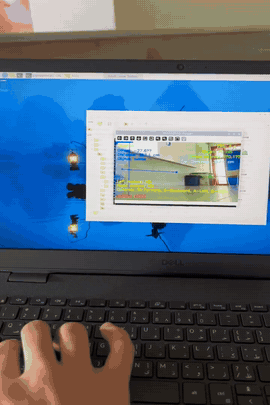
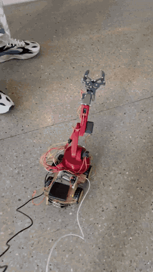
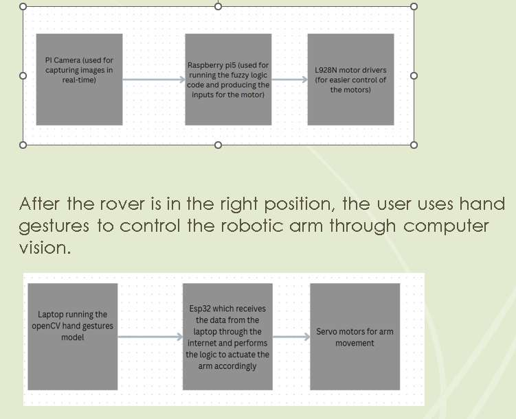
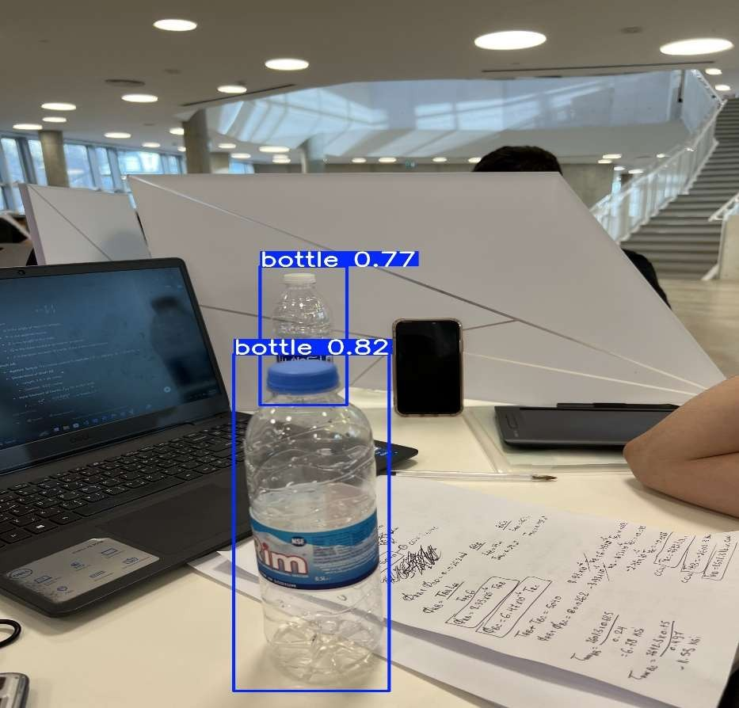

# Autonomous Garbage-Collecting Rover

A rover that detects bottles and cans in real time, steers itself to them with a fuzzy logic controller, and carries a 6-DOF robotic arm that the operator drives with hand gestures.

<p align="center">
  
  &nbsp;
  
</p>

**Course:** Mechatronics System Design II, Lebanese American University (Spring 2025)
**Team:** Khalid Kaddoura, Vartan Fakhreddine, Rayan Abou Matar

## What I did

- Deployed a YOLOv8 nano detector on a Raspberry Pi 5 with a Pi Camera V2 to find bottles and cans in real time.
- Responsible for actuation and sensing: the DC drive motors through the L298N driver, the arm's servos on the ESP32, and the Pi Camera V2.
- Implemented the Mamdani fuzzy controller that turns object offset and distance into left and right motor speeds, designed in MATLAB and ported to Python on the Pi.
- Developed the webcam gesture control: MediaPipe hand landmarks become a five-finger code, mapped to 13 arm commands and sent to the ESP32 over WebSocket.

## How it works

<p align="center"></p>

1. **Detect.** YOLOv8 nano runs on the Raspberry Pi 5 and finds bottles and cans in the Pi Camera V2 feed.
2. **Estimate.** The object's horizontal offset from the image center and its distance (pinhole camera model, single camera) are computed.
3. **Steer.** A Mamdani fuzzy controller (min–max inference, centroid defuzzification) maps offset and distance to PWM for the left and right motors, centering the object and driving toward it. A keyboard override covers cases where the object leaves the frame.
4. **Pick.** On a laptop, MediaPipe tracks the operator's hand. Each held gesture maps to an arm command, sent as JSON over WebSocket to the ESP32 that drives the six servos.

## Results

| Metric | Value |
|---|---|
| Training dataset | 3,742 images, 2 classes (bottle, can) |
| mAP@0.5 | 0.95 |
| mAP@0.5:0.95 | 0.82 |
| Correct class (bottle / can) | 91% / 98% |
| Gesture commands | 13, covering 6 joints |

<p align="center"></p>

<details>
<summary>Gesture map</summary>

| Gesture | Finger code | Command |
|---|---|---|
| Fist | 00000 | Stop all |
| Index | 01000 | Shoulder ↑ |
| Index + middle | 01100 | Shoulder ↓ |
| Thumb | 10000 | Elbow ↑ |
| Thumb + index | 11000 | Elbow ↓ |
| Pinky | 00001 | Wrist pitch ↑ |
| Pinky + index | 01001 | Wrist pitch ↓ |
| Thumb + index + pinky | 11001 | Wrist roll → |
| Thumb + pinky | 10001 | Wrist roll ← |
| Thumb + index + middle | 11100 | Base rotate → |
| Ring + middle + pinky | 00111 | Base rotate ← |
| All fingers | 11111 | Gripper open |
| All except thumb | 01111 | Gripper close |

</details>

## Repository structure

```
src/
  raspberry-pi/rover_fuzzy_control.py      detection, distance estimation, fuzzy motor control
  gesture-control/hand_gesture_control.py  MediaPipe gestures → WebSocket commands
  esp32/esp32_arm_control/                 ESP32 sketch driving the 6 arm servos
matlab/fuzzy/                              Mamdani controller design (.fis) and script
docs/MSD2_Project_Report.pdf               full report
media/                                     GIFs, figures and demo video
```

## How to run

**Rover (Raspberry Pi 5)**
```bash
cd src/raspberry-pi
pip install -r requirements.txt
python rover_fuzzy_control.py --model path/to/yolov8n_bottles_cans.pt
```
Options include `--confidence`, `--resolution`, `--track-class`, `--target-distance` and `--simulation` (run `--help` for all).

**Arm (ESP32)**
Open `src/esp32/esp32_arm_control/esp32_arm_control.ino` in the Arduino IDE, install the ESP32Servo, WebSockets and ArduinoJson libraries, set your Wi-Fi SSID and password at the top of the sketch, and upload.

**Gesture control (laptop)**
```bash
cd src/gesture-control
pip install -r requirements.txt
python hand_gesture_control.py   # enter the ESP32's IP address when asked
```

## Hardware

Raspberry Pi 5 · Pi Camera V2 · ESP32 · 6-DOF 3D-printed arm · DC motors with L298N driver

## Limitations and next steps

The single camera limits distance estimation and loses objects that leave the frame, and the Pi's compute budget kept the full pipeline at a low frame rate. A second camera, a larger garbage dataset and a fully autonomous pick are the natural next steps.

Portfolio: [khalidkadd1.github.io](https://khalidkadd1.github.io)
